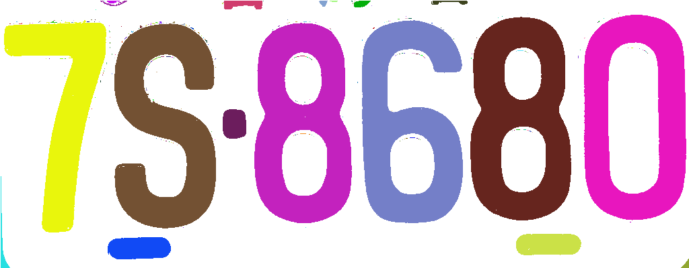

# DIP Course Projects

This repository contains a collection of Digital Image Processing (DIP) course assignments implemented in C++ using OpenCV.

All assignments have been consolidated into a single project framework and can be selected and executed through a unified menu system.

## Demo

### Connected Component Labeling

Input image:


Result:



The implementation applies:

- Otsu Thresholding
- Connected Component Labeling (CCL)
- Union-Find Label Equivalence Resolution
- Random Color Visualization

Each connected region is assigned a unique label and visualized with a distinct color.


## Features

- C++
- OpenCV 5
- MSYS2 UCRT64
- Makefile Build System
- Function-based Project Architecture
- VS Code Development Environment

## Project Structure

```text
DIP_Projects
├── Course_Lib/
│   ├── myHist.cpp
│   └── myHist.h
│
├── HW/
│   ├── ImageFlip.cpp
│   ├── BoxFilter.cpp
│   ├── MedianFilter.cpp
│   ├── GaussianNoise.cpp
│   ├── UniformNoise.cpp
│   ├── SaltPepperNoise.cpp
│   ├── HistogramEqualization.cpp
│   ├── HistogramMatching.cpp
│   ├── LaplacianEnhancement.cpp
│   └── ConnectedComponentLabeling.cpp
│
├── images/
├── DIP.cpp
├── Makefile
└── README.md
```

## Assignments

### 1. Image Flip

- Flip image vertically
- Mirror image horizontally

### 2. Box Filter

- Mean filtering
- Image smoothing

### 3. Median Filter

- Median filtering
- Salt-and-pepper noise reduction

### 4. Gaussian Noise

- Gaussian-distributed noise generation
- Image degradation simulation

### 5. Uniform Noise

- Uniform noise generation
- Noise analysis

### 6. Salt-and-Pepper Noise

- Random impulse noise generation
- Noise robustness experiments

### 7. Histogram Equalization

- Contrast enhancement
- Histogram redistribution

### 8. Histogram Matching

- Histogram specification
- Gray-level distribution transfer

### 9. Laplacian Enhancement

- Laplacian filtering
- Edge enhancement

### 10. Connected Component Labeling

- Otsu Thresholding
- Connected Component Labeling (CCL)
- Union-Find Label Equivalence Resolution
- Colorized Component Visualization

## Build

```bash
make
```

## Run

```bash
./dip.exe
```

Select a function from the menu:

```text
========== DIP Homework ==========
1. Image Flip
2. Box Filter
3. Median Filter
4. Histogram Equalization
5. Histogram Matching
6. Laplacian Enhancement
7. Gaussian Noise
8. Uniform Noise
9. Salt Pepper Noise
10. Connected Component Labeling
```

## Dependencies

- OpenCV 5
  - Official Website: https://opencv.org/
  - Documentation: https://docs.opencv.org/
  - Tutorials: https://docs.opencv.org/5.x/

- MSYS2 UCRT64
  - Official Website: https://www.msys2.org/
  - UCRT64 Environment Guide: https://www.msys2.org/docs/environments/
  - Installation Guide: https://www.mingw-w64.org/getting-started/msys2/

- GNU Make
  - Official Manual: https://www.gnu.org/software/make/manual/
  - HTML Documentation: https://www.gnu.org/software/make/manual/html_node/

- GCC
  - Official Documentation: https://gcc.gnu.org/onlinedocs/
