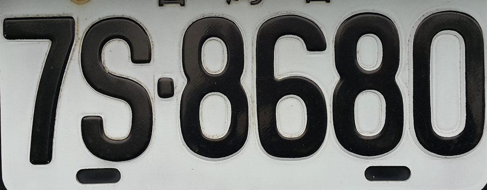

# DIP Course Projects

This repository contains a collection of Digital Image Processing (DIP) course assignments implemented in C++ using OpenCV.

All assignments have been consolidated into a single project framework and can be selected and executed through a unified menu system.

## Demo

### Connected Component Labeling

Input image:



Result:


The implementation applies:

- Otsu Thresholding
- Connected Component Labeling (CCL)
- Union-Find Label Equivalence Resolution
- Random Color Visualization

Each connected region is assigned a unique label and visualized with a distinct color.


## Features

- C++
- OpenCV 5
- MSYS2 UCRT64
- Makefile Build System
- Function-based Project Architecture
- VS Code Development Environment

## Project Structure

```text
DIP_Projects
├── Course_Lib/
│   ├── myHist.cpp
│   └── myHist.h
│
├── HW/
│   ├── ImageFlip.cpp
│   ├── BoxFilter.cpp
│   ├── MedianFilter.cpp
│   ├── GaussianNoise.cpp
│   ├── UniformNoise.cpp
│   ├── SaltPepperNoise.cpp
│   ├── HistogramEqualization.cpp
│   ├── HistogramMatching.cpp
│   ├── LaplacianEnhancement.cpp
│   └── ConnectedComponentLabeling.cpp
│
├── images/
├── DIP.cpp
├── Makefile
└── README.md
```

## Assignments

### 1. Image Flip


- Implemented vertical and horizontal image flipping through direct pixel-wise coordinate transformation.
- Performed manual coordinate remapping on a grayscale image without relying on OpenCV's built-in `flip()` function.
- Generated an upside-down image by reversing pixel positions along the vertical axis.
- Generated a mirror-reflected image by reversing pixel positions along the horizontal axis.
- Preserved original pixel intensity values while modifying only their spatial coordinates.
- Demonstrated fundamental geometric image processing using explicit pixel manipulation and coordinate mapping.

Coordinate Transformations:

Vertical Flip:

```text
(r, c) → (H - 1 - r, c)
```

Horizontal Flip:

```text
(r, c) → (r, W - 1 - c)
```

Implementation Workflow:

1. Read the grayscale input image.
2. Traverse every pixel in the image.
3. Copy each pixel to its vertically transformed position.
4. Copy each pixel to its horizontally transformed position.
5. Display the original image and both transformed results.

where:

- `H` represents the image height.
- `W` represents the image width.
- `r` and `c` represent the row and column coordinates of a pixel.
- The pixel intensity remains unchanged during the transformation.
- Only the spatial location of each pixel is modified.

Benefits:

- Demonstrates fundamental geometric image transformations.
- Illustrates coordinate-based image manipulation techniques.
- Helps understand spatial-domain image processing concepts.
- Provides a low-level implementation without using high-level OpenCV transformation APIs.

### 2. Box Filter


- Implemented a custom 3×3 weighted smoothing filter using direct neighborhood convolution.
- Applied manual kernel traversal and weighted pixel accumulation without relying on OpenCV's built-in filtering functions.
- Computed each output pixel as a weighted average of its surrounding neighborhood to reduce local intensity variations and suppress high-frequency noise.
- Utilized a Gaussian-like weighting scheme that assigns higher importance to pixels closer to the kernel center.
- Performed explicit boundary handling and intensity clipping to maintain valid grayscale values in the range of 0–255.
- Generated and compared image histograms before and after filtering to analyze the impact of spatial-domain smoothing on intensity distribution.

Convolution Kernel:

| 1 | 2 | 1 |
|---|---|---|
| 2 | 4 | 2 |
| 1 | 2 | 1 |

Normalization Factor:

`1 / 16`

Filtering Workflow:

1. Extract a 3×3 neighborhood around the target pixel.
2. Multiply each neighboring pixel by its corresponding kernel weight.
3. Accumulate all weighted values.
4. Divide the result by the normalization factor (16).
5. Clamp the output intensity to the valid grayscale range.
6. Store the filtered value in the output image.

Output Pixel Computation:

```text
g(r,c) = (Σ wi × f(r+Δri, c+Δci)) / 16
```

where:

- `f(r,c)` represents the input image intensity.
- `g(r,c)` represents the filtered image intensity.
- `wi` represents the kernel weight.
- `Δri` and `Δci` represent neighboring pixel offsets within the 3×3 window.

Benefits:

- Reduces random image noise.
- Smooths local intensity fluctuations.
- Preserves overall image structures while suppressing high-frequency components.
- Demonstrates the fundamentals of spatial-domain convolution and image smoothing.

### 3. Median Filter

- Implemented a custom 3×3 median filter using neighborhood pixel sampling and manual sorting.
- Collected grayscale intensity values from a local 3×3 neighborhood surrounding each pixel.
- Applied a custom QuickSort algorithm to sort neighboring pixel values and determine the median intensity.
- Replaced local pixel values with the median value to suppress impulsive noise while preserving image edges.
- Performed median-based image smoothing without relying on OpenCV's built-in `medianBlur()` API.
- Generated and compared histograms before and after filtering to analyze the effect of median filtering on intensity distribution.

Neighborhood Window:

| P1 | P2 | P3 |
|----|----|----|
| P4 | P5 | P6 |
| P7 | P8 | P9 |

Median Filtering Workflow:

1. Collect 9 neighboring pixel intensities.
2. Sort the intensity values using QuickSort.
3. Select the middle value from the sorted sequence.
4. Assign the median intensity to the corresponding output region.
5. Repeat for all valid pixels in the image.

Median Selection:

```text
Median = SortedValues[N / 2]
```

where:

- `N = 9` for the 3×3 neighborhood.
- `SortedValues` represents the sorted neighboring pixel intensities.
- The median corresponds to the fifth element after sorting.

Benefits:

- Effectively removes salt-and-pepper noise.
- Preserves image edges better than averaging filters.
- Reduces the influence of extreme pixel values.
- Produces smoother images while maintaining important structural details.

### 4. Histogram Equalization


- Implemented histogram equalization for automatic image contrast enhancement.
- Computed the grayscale histogram by counting the occurrence of each intensity level from 0 to 255.
- Normalized the histogram into a Probability Density Function (PDF) to represent the intensity distribution of the image.
- Generated a Cumulative Distribution Function (CDF) and used it to construct an intensity transformation table.
- Applied pixel-wise gray-level remapping to expand the image's dynamic range and improve visual contrast.
- Implemented the entire equalization process manually without using OpenCV's built-in `equalizeHist()` API.
- Generated and compared histograms before and after enhancement to visualize intensity redistribution.

Histogram Equalization Workflow:

1. Calculate histogram H(r)
2. Convert H(r) to PDF
3. Compute cumulative distribution function (CDF)
4. Generate transformation table T(r)
5. Remap all pixels using T(r)

Intensity Mapping:

`T(r) = 255 × CDF(r)`

where:

- `H(r)` represents the histogram of the input image.
- `PDF(r)` represents the normalized probability distribution.
- `CDF(r)` represents the cumulative probability distribution.
- `T(r)` is the equalization transformation function.
- `r` denotes the original gray-level intensity.

Benefits:

- Enhances global image contrast.
- Improves visibility in low-contrast regions.
- Utilizes a wider range of available grayscale intensities.
- Produces a more evenly distributed histogram.

### 5. Histogram Matching

- Implemented histogram matching (histogram specification) to transform the intensity distribution of a source image so that it resembles a target image.
- Computed histograms for both the source image and the target image and normalized them into Probability Density Functions (PDFs).
- Generated Cumulative Distribution Functions (CDFs) for both images to establish their gray-level transformation mappings.
- Constructed a target inverse mapping table to translate equalized source intensities into target intensity levels.
- Created an intensity transfer function that maps each source gray level to the closest corresponding gray level in the target image.
- Performed pixel-wise gray-level remapping without relying on OpenCV's built-in histogram matching functions.
- Visualized and compared the histograms of the source image, target image, and matched result to evaluate distribution similarity.

Histogram Matching Workflow:

1. Calculate the histogram of the source image.
2. Normalize the histogram into a PDF.
3. Generate the source image CDF and transformation table T.
4. Calculate the histogram of the target image.
5. Normalize the histogram into a PDF.
6. Generate the target image CDF and transformation table G.
7. Construct the inverse mapping G⁻¹.
8. Create the matching function Z = G⁻¹(T).
9. Remap all source image pixels using Z.

Transformation Pipeline:

```text
Source Image
      │
      ▼
   Histogram
      │
      ▼
      T
      │
      ▼
   Equalized Space
      │
      ▼
    G⁻¹
      │
      ▼
Matched Output
```

Intensity Mapping:

```text
Z(r) = G⁻¹(T(r))
```

where:

- `T(r)` is the cumulative transformation function of the source image.
- `G(r)` is the cumulative transformation function of the target image.
- `G⁻¹(r)` is the inverse mapping derived from the target CDF.
- `Z(r)` is the final histogram matching transformation.
- `r` represents the original gray-level intensity.

Benefits:

- Transfers the overall brightness and contrast characteristics from a reference image.
- Produces intensity distributions similar to a specified target image.
- Demonstrates histogram specification through cumulative distribution mapping.
- Illustrates inverse transformation and gray-level transfer techniques in digital image processing.
- Useful for image normalization and appearance matching across different image sources.

### 6. Uniform Noise

- Implemented uniform noise generation by adding randomly distributed intensity values to each pixel within a predefined range.
- Simulated image degradation by introducing uniformly distributed noise with amplitudes ranging from -10 to +10 grayscale levels.
- Applied intensity clipping to maintain valid pixel values within the 8-bit grayscale range of 0–255.
- Implemented an adaptive median filtering algorithm to reduce noise while preserving image details.
- Dynamically adjusted the filtering window size from 3×3 up to 7×7 based on local neighborhood statistics.
- Utilized QuickSort to obtain local minimum, maximum, and median values required for adaptive median filtering.
- Generated and compared histograms before noise addition, after noise corruption, and after noise removal to analyze intensity distribution changes.

Uniform Noise Model:

```text
g(r,c) = f(r,c) + n(r,c)
```

where:

- `f(r,c)` is the original image intensity.
- `n(r,c)` is a random value uniformly distributed within [-10, +10].
- `g(r,c)` is the noisy image intensity.

Noise Generation Workflow:

1. Read the original grayscale image.
2. Generate a random noise value in the range [-10, +10].
3. Add the noise value to the original pixel intensity.
4. Clip the result to the valid range [0, 255].
5. Store the noisy image.

Adaptive Median Filtering Workflow:

1. Extract an S×S neighborhood around the target pixel.
2. Sort all pixel values within the neighborhood.
3. Compute:
   - Minimum intensity (`Zmin`)
   - Median intensity (`Zmed`)
   - Maximum intensity (`Zmax`)
4. Evaluate local statistics to determine whether the median is a noise-free representative value.
5. Increase the window size when necessary, up to a maximum size of 7×7.
6. Replace corrupted pixels using the median value while preserving valid pixels.

Adaptive Median Conditions:

```text
A1 = Zmed - Zmin
A2 = Zmed - Zmax
```

```text
B1 = Zxy - Zmin
B2 = Zxy - Zmax
```

where:

- `Zxy` is the current pixel value.
- `Zmin` is the minimum value in the local neighborhood.
- `Zmed` is the median value in the local neighborhood.
- `Zmax` is the maximum value in the local neighborhood.

Benefits:

- Demonstrates random noise simulation using a uniform probability distribution.
- Preserves image structures while reducing noise artifacts.
- Illustrates adaptive median filtering with variable window sizes.
- Provides a practical comparison between noisy and restored images through histogram analysis.
- Helps evaluate the effectiveness of nonlinear denoising techniques in digital image processing.

### 7. Salt-and-Pepper Noise


- Implemented salt-and-pepper noise generation by randomly replacing image pixels with minimum and maximum grayscale values.
- Simulated impulse noise using a noise probability of 20%, where 10% of pixels were set to black (pepper noise) and 10% were set to white (salt noise).
- Preserved the original pixel intensity for the remaining 80% of pixels to create a realistic degraded image.
- Applied an adaptive median filtering algorithm to detect and remove impulsive noise while preserving image edges and fine details.
- Dynamically adjusted the filtering window size from 3×3 to 7×7 according to local neighborhood statistics.
- Utilized QuickSort to obtain neighborhood minimum, median, and maximum values required by the adaptive median filter.
- Generated and compared histograms before noise injection, after noise corruption, and after noise removal to evaluate filtering performance.

Salt-and-Pepper Noise Model:

```text
g(r,c) =
    0      with probability 0.1
    255    with probability 0.1
    f(r,c) with probability 0.8
```

where:

- `f(r,c)` is the original image intensity.
- `g(r,c)` is the noisy image intensity.

Noise Generation Workflow:

1. Generate a random number between 1 and 100.
2. Replace the pixel with:
   - `0` (pepper noise) if the random value is ≤ 10.
   - `255` (salt noise) if the random value is between 11 and 20.
   - Original intensity otherwise.
3. Store the resulting noisy image.

Adaptive Median Filtering Workflow:

1. Extract an S×S neighborhood around the target pixel.
2. Sort all neighborhood pixel intensities.
3. Calculate:
   - Minimum value (`Zmin`)
   - Median value (`Zmed`)
   - Maximum value (`Zmax`)
4. Determine whether the median represents a valid non-noise intensity.
5. Increase the neighborhood size when necessary, up to a maximum window size of 7×7.
6. Replace only corrupted pixels while preserving valid image information.

Adaptive Median Conditions:

```text
A1 = Zmed - Zmin
A2 = Zmed - Zmax
```

```text
B1 = Zxy - Zmin
B2 = Zxy - Zmax
```

where:

- `Zxy` is the current pixel value.
- `Zmin` is the minimum neighborhood intensity.
- `Zmed` is the median neighborhood intensity.
- `Zmax` is the maximum neighborhood intensity.

Noise Parameters:

| Parameter | Value |
|-----------|--------|
| Pepper Noise Probability | 10% |
| Salt Noise Probability | 10% |
| Total Noise Density | 20% |
| Minimum Window Size | 3×3 |
| Maximum Window Size | 7×7 |

Benefits:

- Demonstrates impulse noise generation commonly encountered during image acquisition and transmission.
- Effectively removes salt-and-pepper noise while preserving image structures.
- Retains edge information better than conventional averaging filters.
- Illustrates the advantages of adaptive median filtering over fixed-window approaches.
- Provides quantitative and visual comparison through histogram analysis and image restoration results.

### 8. Gaussian Noise

- Implemented Gaussian noise generation to simulate image degradation caused by sensor noise and acquisition uncertainties.
- Added zero-mean Gaussian-distributed random variations to pixel intensities using a custom probability-based noise generation approach.
- Generated noisy images by perturbing grayscale intensities according to an approximated Gaussian distribution centered around the original pixel value.
- Applied intensity clipping to ensure all pixel values remained within the valid 8-bit grayscale range of 0–255.
- Implemented an adaptive median filtering algorithm to reduce Gaussian noise while preserving important image structures and edges.
- Dynamically adjusted the filtering window size from 3×3 up to 7×7 according to local image statistics.
- Utilized QuickSort to obtain neighborhood minimum, median, and maximum values required during adaptive filtering.
- Generated and compared histograms before noise injection, after Gaussian degradation, and after restoration to evaluate denoising performance.

Gaussian Noise Model:

```text
g(r,c) = f(r,c) + n(r,c)
```

where:

- `f(r,c)` is the original image intensity.
- `n(r,c)` is a Gaussian-distributed random variable.
- `g(r,c)` is the noisy image intensity.

Noise Parameters:

```text
Mean (μ)   = 0
Std Dev(σ) = 3
```

Noise Generation Workflow:

1. Construct an approximate Gaussian probability distribution.
2. Generate a random value according to the distribution.
3. Add the generated noise value to the original pixel intensity.
4. Clip the result to the valid range [0, 255].
5. Store the resulting noisy image.

Adaptive Median Filtering Workflow:

1. Extract an S×S neighborhood around the target pixel.
2. Sort all pixel intensities within the neighborhood.
3. Compute:
   - Minimum intensity (`Zmin`)
   - Median intensity (`Zmed`)
   - Maximum intensity (`Zmax`)
4. Determine whether the median represents a valid local intensity.
5. Expand the neighborhood size when necessary, up to a maximum size of 7×7.
6. Replace noisy pixels using the median value while preserving non-corrupted pixels.

Adaptive Median Conditions:

```text
A1 = Zmed - Zmin
A2 = Zmed - Zmax
```

```text
B1 = Zxy - Zmin
B2 = Zxy - Zmax
```

where:

- `Zxy` is the current pixel value.
- `Zmin` is the minimum neighborhood intensity.
- `Zmed` is the median neighborhood intensity.
- `Zmax` is the maximum neighborhood intensity.

Noise Distribution Characteristics:

- Highest probability near the original pixel intensity.
- Probability decreases as the deviation from the mean increases.
- Produces natural-looking noise commonly observed in imaging systems.
- Simulates random intensity fluctuations introduced during image acquisition.

Benefits:

- Demonstrates Gaussian noise modeling and simulation.
- Illustrates image degradation caused by stochastic sensor noise.
- Shows adaptive median filtering for image restoration.
- Preserves important structures while reducing random fluctuations.
- Enables visual and statistical comparison through histogram analysis.

### 9. Laplacian Enhancement

- Implemented Laplacian-based image enhancement to sharpen image details and emphasize edge information.
- Applied a custom 3×3 Laplacian convolution kernel through manual neighborhood traversal and weighted pixel accumulation.
- Enhanced high-frequency image components by amplifying local intensity transitions and object boundaries.
- Performed spatial-domain filtering without relying on OpenCV's built-in sharpening or edge enhancement functions.
- Applied intensity clipping to maintain valid grayscale values within the range of 0–255.
- Generated and compared image histograms before and after enhancement to analyze changes in intensity distribution.

Laplacian Kernel:

| 0 | -1 | 0 |
|---|---|---|
| -1 | 5 | -1 |
|---|---|---|
| 0 | -1 | 0 |

Enhancement Workflow:

1. Extract a 3×3 neighborhood around the target pixel.
2. Multiply each neighboring pixel by its corresponding Laplacian kernel weight.
3. Accumulate all weighted values.
4. Clamp the result to the valid grayscale range [0, 255].
5. Store the enhanced value in the output image.

Output Pixel Computation:

```text
g(r,c) = Σ wi × f(r+Δri, c+Δci)
```

where:

- `f(r,c)` represents the input image intensity.
- `g(r,c)` represents the enhanced image intensity.
- `wi` represents the Laplacian kernel weight.
- `Δri` and `Δci` represent neighboring pixel offsets.

Sharpening Characteristics:

- Positive center weight increases the contribution of the current pixel.
- Negative neighboring weights emphasize local intensity differences.
- Enhances edges, fine textures, and high-frequency details.
- Produces a sharper appearance compared to the original image.

Benefits:

- Enhances edge visibility and image sharpness.
- Improves local contrast around object boundaries.
- Demonstrates spatial-domain image enhancement using convolution.
- Illustrates the relationship between second-order derivatives and edge detection.
- Provides histogram-based visualization of enhancement results.

### 10. Connected Component Labeling

- Implemented an end-to-end connected component analysis pipeline for object segmentation and region identification.
- Applied Otsu's thresholding algorithm to automatically determine the optimal grayscale threshold for image binarization.
- Converted the input grayscale image into a binary image using the computed optimal threshold.
- Developed a custom two-pass Connected Component Labeling (CCL) algorithm without relying on OpenCV's built-in component analysis functions.
- Assigned provisional labels to foreground pixels while tracking label equivalence relationships during the first pass.
- Implemented a Union-Find (Disjoint Set) data structure with path compression and union-by-rank optimization to efficiently resolve equivalent labels.
- Performed relabeling to generate compact and contiguous component identifiers.
- Generated a random color palette to visualize individual connected regions and distinguish segmented objects.
- Produced a colorized component map for intuitive inspection of connected foreground regions.

Processing Pipeline:

```text
Input Image
     │
     ▼
Histogram Analysis
     │
     ▼
Otsu Thresholding
     │
     ▼
Binary Image
     │
     ▼
Connected Component Labeling
     │
     ▼
Union-Find Equivalence Resolution
     │
     ▼
Relabeling
     │
     ▼
Colorized Component Visualization
```

Otsu Thresholding Workflow:

1. Compute the normalized image histogram.
2. Evaluate all possible threshold values from 0 to 255.
3. Calculate the between-class variance for each threshold.
4. Select the threshold that maximizes the between-class variance.
5. Generate a binary image using the optimal threshold.

Otsu Criterion:

```text
σ²b = p0 × p1 × (μ0 - μ1)²
```

where:

- `p0` is the probability of the background class.
- `p1` is the probability of the foreground class.
- `μ0` is the mean intensity of the background.
- `μ1` is the mean intensity of the foreground.
- `σ²b` is the between-class variance.

Connected Component Labeling Workflow:

Pass 1:

1. Scan the image from top to bottom and left to right.
2. Examine the upper and left neighboring pixels.
3. Assign a new label when no labeled neighbors exist.
4. Assign the minimum neighboring label when labeled neighbors are present.
5. Record label equivalence relationships when multiple neighboring labels are detected.

Pass 2:

1. Resolve equivalent labels using Union-Find.
2. Replace provisional labels with their representative labels.
3. Relabel components with consecutive identifiers.
4. Generate the final labeled image.

Union-Find Optimizations:

```text
- Path Compression
- Union by Rank
```

Foreground Connectivity:

```text
Neighbor Check:
 ┌───┬───┐
 │ U │   │
 ├───┼───┤
 │ L │ X │
 └───┴───┘
```

where:

- `X` is the current foreground pixel.
- `U` is the upper neighbor.
- `L` is the left neighbor.

Visualization:

- Background pixels are displayed in white.
- Each connected component is assigned a unique randomly generated color.
- Objects belonging to the same connected region share the same label and color.

Benefits:

- Demonstrates automatic image segmentation using Otsu thresholding.
- Implements a complete two-pass Connected Component Labeling algorithm.
- Efficiently resolves label equivalence through Union-Find optimization.
- Enables object extraction and region-based image analysis.
- Provides intuitive visual verification through colorized component maps.
- Illustrates fundamental techniques used in OCR, license plate analysis, document processing, and industrial vision systems.

## Build

```bash
make
```

## Run

```bash
./dip.exe
```

Select a function from the menu:

```text
========== DIP Homework ==========
1. Image Flip
2. Box Filter
3. Median Filter
4. Histogram Equalization
5. Histogram Matching
6. Laplacian Enhancement
7. Gaussian Noise
8. Uniform Noise
9. Salt Pepper Noise
10. Connected Component Labeling
```

## Dependencies

- OpenCV 5
  - Official Website: https://opencv.org/
  - Documentation: https://docs.opencv.org/
  - Tutorials: https://docs.opencv.org/5.x/

- MSYS2 UCRT64
  - Official Website: https://www.msys2.org/
  - UCRT64 Environment Guide: https://www.msys2.org/docs/environments/
  - Installation Guide: https://www.mingw-w64.org/getting-started/msys2/

- GNU Make
  - Official Manual: https://www.gnu.org/software/make/manual/
  - HTML Documentation: https://www.gnu.org/software/make/manual/html_node/

- GCC
  - Official Documentation: https://gcc.gnu.org/onlinedocs/
